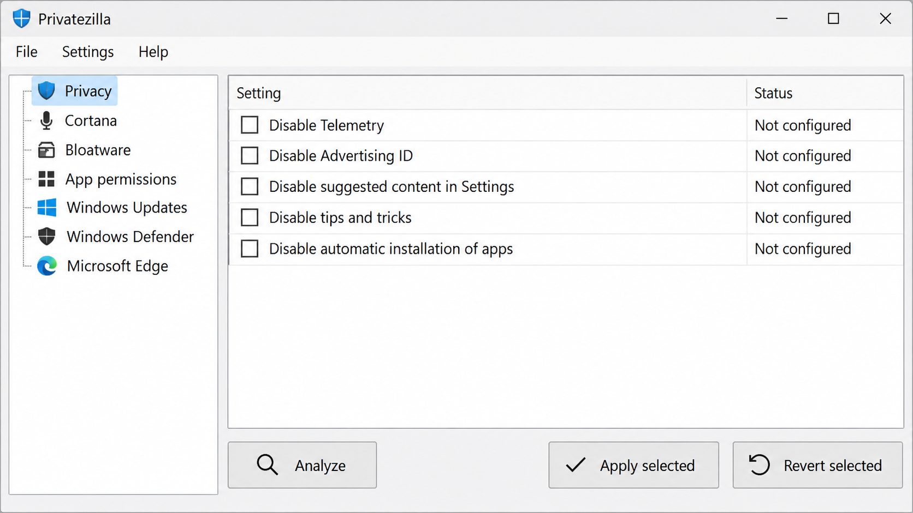
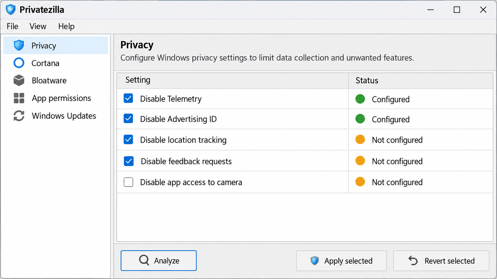
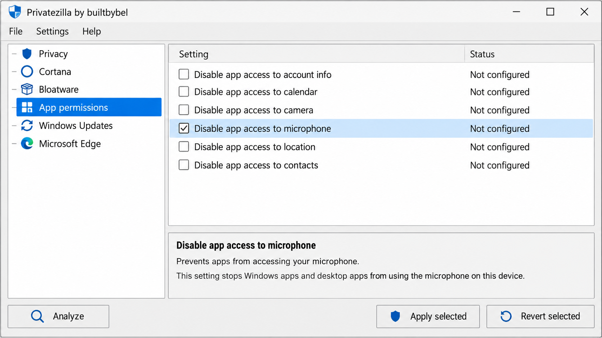

# Privatezilla Telemetry Blocker - Privacy And Security Checker For Windows 10

> **Privatezilla Telemetry Blocker is deprecated.** The final release is Privatezilla v0.60.0 Pollux, designed for Windows 10 versions 1809 through 2009. Modern Windows 11 systems are not officially supported.

Privatezilla Telemetry Settings preserves the Privatezilla Telemetry Blocker source for privacy analysis, telemetry control, application-permission management, and reversible Windows 10 configuration.

## Contents

- [About](#about)
- [Key Features](#key-features)
- [Download](#download)
- [Usage](#usage)
- [Features](#features)
- [Compatibility](#compatibility)
- [Community Package](#community-package)
- [Details](#details)
- [Translating The App](#translating-the-app)
- [Contributing](#contributing)
- [Security Policy](#security-policy)
- [Changelog](#changelog)
- [Credits And Acknowledgments](#credits-and-acknowledgments)
- [License](#license)

## About

Privatezilla Telemetry Blocker provides a centralized interface for checking critical Windows 10 privacy and security settings. It labels active protections as configured and identifies settings that remain unconfigured, allowing users to analyze the system before applying changes.

Privatezilla Telemetry Settings includes the original C# implementation of privacy, application-access, Cortana, Edge, gaming, security, bloatware, and Windows Update controls. The interface supports enabling and disabling available settings without requiring users to locate every corresponding registry policy manually.

### Privatezilla At A Glance

privatezilla telemetry blocker, privatezilla telemetry blocker windows 10, privatezilla telemetry blocker windows 11, privatezilla telemetry blocker builtbybel, privatezilla v0.60.0 pollux, windows-privacy, windows-10, telemetry-blocker, privacy-settings, windows-debloat, system-tweaks, diagnostic-data, bloatware-removal

### System Requirements

- Windows 10 versions 1809 through 2009.
- An account with administrative privileges for system-wide changes.
- A compatible Windows desktop environment for the C# application.
- A backup or restore point before applying privacy or system changes.

## Key Features

- Analyze configured and unconfigured privacy settings.
- Disable Windows diagnostic data and compatibility telemetry.
- Disable advertising identifiers, suggestions, experiments, and feedback prompts.
- Restrict background applications and sensitive application permissions.
- Disable Cortana and Bing integration.
- Remove default or all selected UWP applications.
- Disable Game Bar features and Windows Update sharing.
- Apply individual settings instead of an opaque all-or-nothing preset.
- Revert supported settings to their expected Windows defaults.
- Review the complete implementation before running it.

The privacy implementation is organized under [`Settings/Privacy`](src/Privatezilla/Settings/Privacy), while application permissions are represented by individual classes under [`Settings/Apps`](src/Privatezilla/Settings/Apps).

### Why is Microsoft Compatibility telemetry using a high CPU?

Microsoft Compatibility Telemetry can consume significant CPU, disk, or memory while Windows inventories applications, drivers, hardware, and compatibility data. Activity may increase after an update, during scheduled assessment tasks, or when a compatibility database is rebuilt.

Privatezilla Telemetry Blocker includes a dedicated [`DisableCompTelemetry.cs`](src/Privatezilla/Settings/Privacy/DisableCompTelemetry.cs) setting intended to reduce compatibility telemetry collection. It also includes separate controls for [`DiagnosticData.cs`](src/Privatezilla/Settings/Privacy/DiagnosticData.cs), [`DisableTelemetry.cs`](src/Privatezilla/Settings/Privacy/DisableTelemetry.cs), and [`InventoryCollector.cs`](src/Privatezilla/Settings/Privacy/InventoryCollector.cs).

Disabling these settings may reduce recurring telemetry work, but high CPU usage is not proof that telemetry is the only cause. Users should first inspect the active process, scheduled task, update state, and resource history. Privatezilla Telemetry Settings does not guarantee that every compatibility scan or Windows maintenance operation will stop.

## Download

## Usage

1. Back up important data and create a Windows restore point.
2. Start Privatezilla Telemetry Blocker with administrative privileges.
3. Select the settings that should be checked.
4. Run the analysis before applying changes.
5. Review every configured and unconfigured result.
6. Apply only the settings whose effects you understand.
7. Restart Windows when a changed policy requires it.
8. Use the revert option if a supported change causes unwanted behavior.

### Analyze

The analysis workflow compares the current Windows configuration with the state expected by each selected setting. A configured result indicates that the corresponding privacy rule is active. A not-configured result indicates that Privatezilla Telemetry Blocker did not find the expected policy or registry state.

The main workflow is implemented in [`MainWindow.cs`](src/Privatezilla/MainWindow.cs), with registry access centralized through [`RegistryHelper.cs`](src/Privatezilla/Helpers/RegistryHelper.cs). Settings inherit shared behavior from [`SetttingsBase.cs`](src/Privatezilla/Helpers/SetttingsBase.cs) and are represented in the interface through [`SettingsNode.cs`](src/Privatezilla/Helpers/SettingsNode.cs).

### Apply And Revert

Privatezilla Telemetry Blocker can apply selected settings and revert supported settings individually. The revert operation targets the Windows default expected by the original project and should not be treated as a complete system snapshot.

Privatezilla revert settings cannot restore unrelated manual edits, deleted user data, or changes made by another privacy utility. Users should retain an independent backup because Windows updates can also alter or replace policies after Privatezilla Telemetry Blocker applies them.

### Which Windows services should I disable?

There is no universal list of Windows services that every user should disable. A service required on one computer may be unnecessary on another, and disabling authentication, networking, update, security, location, or device services can break operating-system features.

Privatezilla Telemetry Blocker focuses on explicit privacy settings rather than indiscriminately disabling every service. Users should begin with narrow controls such as [`DisableTelemetry.cs`](src/Privatezilla/Settings/Privacy/DisableTelemetry.cs), [`DisableFeedback.cs`](src/Privatezilla/Settings/Privacy/DisableFeedback.cs), or [`UpdatesSharing.cs`](src/Privatezilla/Settings/Updates/UpdatesSharing.cs).

Privatezilla Telemetry Settings recommends analyzing each setting, understanding its scope, and changing one category at a time. Do not disable Windows Defender or another security component merely because it runs in the background. A privacy adjustment should not reduce system security without a documented operational reason.

## Features

### Privacy And Diagnostic Data

Privatezilla disable Windows 10 telemetry settings cover diagnostic data, compatibility telemetry, feedback, experiments, inventory collection, timeline activity, tips, suggested content, location, and advertising.

Relevant implementations include:

- [`DiagnosticData.cs`](src/Privatezilla/Settings/Privacy/DiagnosticData.cs)
- [`DisableAds.cs`](src/Privatezilla/Settings/Privacy/DisableAds.cs)
- [`DisableCEIP.cs`](src/Privatezilla/Settings/Privacy/DisableCEIP.cs)
- [`DisableCompTelemetry.cs`](src/Privatezilla/Settings/Privacy/DisableCompTelemetry.cs)
- [`DisableFeedback.cs`](src/Privatezilla/Settings/Privacy/DisableFeedback.cs)
- [`DisableMSExperiments.cs`](src/Privatezilla/Settings/Privacy/DisableMSExperiments.cs)
- [`DisableTelemetry.cs`](src/Privatezilla/Settings/Privacy/DisableTelemetry.cs)
- [`DisableTimeline.cs`](src/Privatezilla/Settings/Privacy/DisableTimeline.cs)

### What happens if you disable telemetry?

Disabling telemetry reduces the diagnostic and usage information that Windows is configured to send to Microsoft. Depending on the selected Privatezilla Telemetry Blocker settings, this can include compatibility inventory, feedback requests, advertising identifiers, experiments, activity history, and suggested content.

The change may reduce background activity and personalized recommendations, but it does not make Windows silent or anonymous. Security services, update infrastructure, certificate validation, Microsoft Store components, and other enabled features may still communicate with Microsoft services.

Some diagnostic functions can support troubleshooting, compatibility assessment, and update readiness. Privatezilla Telemetry Settings therefore exposes separate controls instead of assuming every telemetry-related feature should be disabled. Users can analyze the current state, apply only the required protections, and use Privatezilla revert settings if a supported feature stops working as expected.

### Application Permissions

Privatezilla Telemetry Blocker can review access to account information, notifications, calendar data, call history, camera, contacts, documents, email, file systems, messaging, microphone, motion data, pictures, radios, tasks, and videos.

The application also includes dedicated controls for [`BackgroundApps.cs`](src/Privatezilla/Settings/Apps/BackgroundApps.cs), [`DiagnosticInformation.cs`](src/Privatezilla/Settings/Apps/DiagnosticInformation.cs), and [`TrackingApps.cs`](src/Privatezilla/Settings/Apps/TrackingApps.cs).

### Bloatware And UWP Applications

Privatezilla remove Windows 10 bloatware functionality is implemented through:

- [`RemoveUWPDefaults.cs`](src/Privatezilla/Settings/Bloatware/RemoveUWPDefaults.cs)
- [`RemoveUWPAll.cs`](src/Privatezilla/Settings/Bloatware/RemoveUWPAll.cs)
- [`UWPAppsEngine.cs`](src/Privatezilla/Settings/Bloatware/UWPAppsEngine.cs)

Removing every UWP package can affect Store applications, shell integrations, and user workflows. Review the selected operation before applying it, especially on an existing user profile.

The historical community package also offered Privatezilla remove OneDrive functionality. That package is not part of the retained source tree documented here, so this repository does not claim that its removed scripts remain available.

### Cortana

Privatezilla disable Cortana controls include:

- [`DisableCortana.cs`](src/Privatezilla/Settings/Cortana/DisableCortana.cs)
- [`DisableBing.cs`](src/Privatezilla/Settings/Cortana/DisableBing.cs)
- [`UninstallCortana.cs`](src/Privatezilla/Settings/Cortana/UninstallCortana.cs)

Disabling a feature and uninstalling it are different operations. Analyze the system and choose the least destructive action that meets the required privacy objective.

### Edge, Gaming, Security, And Updates

Privatezilla Telemetry Blocker includes controls for Edge background behavior, synchronization, automatic rollout, Game Bar, SmartScreen for Store applications, major feature updates, update safeguards, automatic updates, and update sharing.

These settings are implemented under:

- [`Settings/Edge`](src/Privatezilla/Settings/Edge)
- [`Settings/Gaming`](src/Privatezilla/Settings/Gaming)
- [`Settings/Defender`](src/Privatezilla/Settings/Defender)
- [`Settings/Security`](src/Privatezilla/Settings/Security)
- [`Settings/Updates`](src/Privatezilla/Settings/Updates)

## Compatibility

| Platform | Status | Notes |
|---|---|---|
| Windows 10 1809–2009 | Supported by the original release | This is the documented Privatezilla Windows 10 target range. |
| Newer Windows 10 releases | Unverified | Policies and registry behavior may have changed. |
| Windows 11 | Unsupported | Privatezilla Telemetry Blocker Windows 11 use can miss modern telemetry controls or apply obsolete registry values. |
| Windows Server | Unsupported | The original application does not document Windows Server compatibility. |

### What does Windows 11 telemetry do?

Windows 11 collects diagnostic information used for reliability, compatibility, updates, security analysis, and product improvement. Optional features can also use activity, advertising, recommendation, location, and application-usage data.

Privatezilla Telemetry Blocker Windows 11 support was never established. The application was engineered around Windows 10 versions 1809 through 2009, while Windows 11 introduced different components, policies, interfaces, and telemetry structures. A configured result from an old rule does not prove that all modern telemetry paths are blocked.

The documented Privatezilla replacement xd-AntiSpy targets newer Windows versions and continues the developer’s privacy-configuration direction. This repository preserves Privatezilla Telemetry Blocker builtbybel source behavior and should not be represented as an actively maintained Windows 11 privacy solution.

## Community Package

The original Privatezilla Telemetry Blocker community package added advanced PowerShell operations for application removal, OneDrive removal, Start menu changes, third-party telemetry rules, firewall blocking, hosts-file blocking, and automation templates.

Those PowerShell package files are not present in this selected repository. Privatezilla Telemetry Settings therefore documents the historical feature without presenting it as an included or supported component.

## Details

- **Application:** Privatezilla Telemetry Blocker
- **Organization:** Privatezilla Telemetry Settings
- **Final Release:** Privatezilla v0.60.0 Pollux
- **Primary Language:** C#
- **Interface:** Windows desktop application
- **Original Target:** Windows 10 versions 1809 through 2009
- **Project Status:** Privatezilla deprecated
- **Successor:** Privatezilla replacement xd-AntiSpy

The primary project is defined in [`Privatezilla.csproj`](src/Privatezilla/Privatezilla.csproj). Developers can open [`Privatezilla.sln`](src/Privatezilla/Privatezilla.sln), inspect [`Program.cs`](src/Privatezilla/Program.cs), and review the application manifest in [`app.manifest`](src/Privatezilla/app.manifest).

## Translating The App

Privatezilla Telemetry Blocker includes resource files for Arabic, German, Spanish, French, Italian, Russian, Turkish, and Chinese. The default resource definitions are stored in [`Locale.resx`](src/Privatezilla/Locales/Locale.resx), with generated accessors in [`Locale.Designer.cs`](src/Privatezilla/Locales/Locale.Designer.cs).

Contributors should preserve resource keys and add translations to the corresponding locale file. Interface changes should remain compatible with [`MainWindow.resx`](src/Privatezilla/MainWindow.resx) and [`MainWindow.Designer.cs`](src/Privatezilla/MainWindow.Designer.cs).

## Contributing

Privatezilla Telemetry Settings accepts changes that preserve the observed behavior and compatibility scope of Privatezilla Telemetry Blocker. Read the [contribution guidelines](.github/CONTRIBUTING.md) and [code of conduct](CODE_OF_CONDUCT.md) before proposing a change.

Contributions should:

- Keep settings focused and independently reviewable.
- Provide a corresponding revert path where the original architecture supports one.
- Avoid claiming Windows 11 compatibility without verified behavior.
- Document registry, policy, privilege, and restart requirements.
- Preserve localization resources when changing interface text.
- Avoid bundling generated binaries or temporary build output.
- Report defects with the [bug report template](.github/ISSUE_TEMPLATE/bug_report.md).

## Security Policy

Privacy utilities operate with elevated privileges and can alter system-wide policy. Review [`SECURITY.md`](SECURITY.md) before reporting a vulnerability.

Security reports should identify the affected setting, required privilege level, trigger, modified registry or policy state, observed impact, and a safe reproduction procedure. Do not describe an unsupported configuration as secure merely because Privatezilla Telemetry Blocker reports it as configured.

## Changelog

Historical release information is maintained in [`CHANGELOG.md`](CHANGELOG.md). Privatezilla v0.60.0 Pollux remains the final documented release, and Privatezilla deprecated status should be considered before deploying it on any current Windows installation.

## Credits And Acknowledgments

Privatezilla Telemetry Blocker was created by Builtbybel and evolved from earlier privacy-checking work referenced by the original project. Privatezilla Telemetry Settings preserves the selected source files, localization resources, contribution documents, and privacy-setting implementations for review and maintenance.

A Privatezilla review should account for both its clear, inspectable C# architecture and its age. The application remains useful as a reference for Windows 10 privacy policy handling, but its original compatibility limits must remain visible.

## License

See [`LICENSE`](LICENSE).
